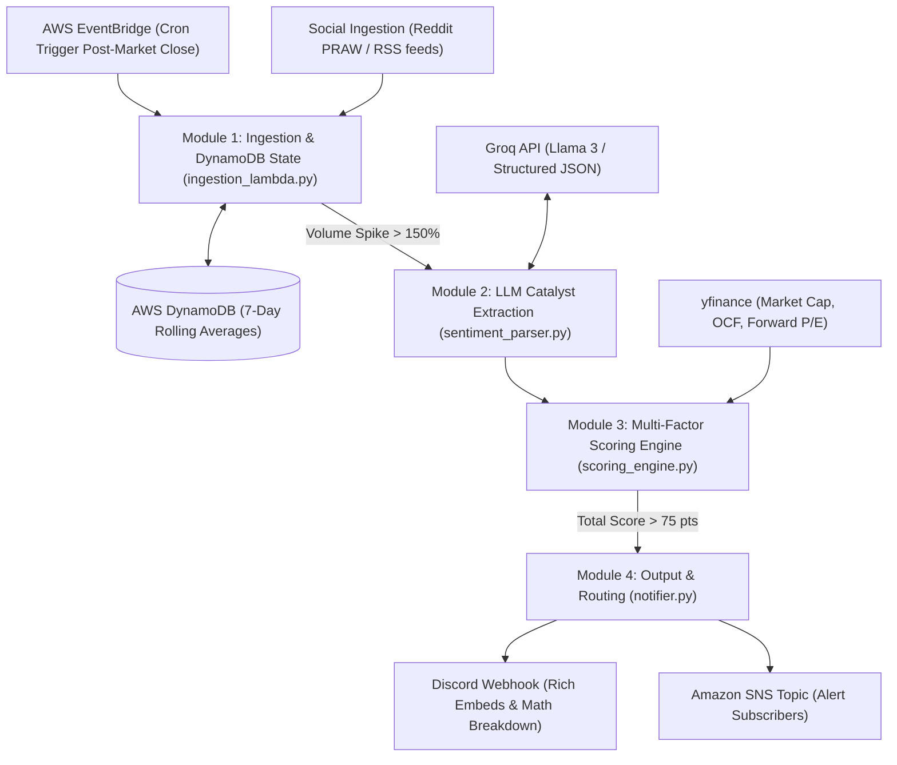

# Multi-Factor Stock Scoring Engine v2.0

An event-driven serverless pipeline on AWS that evaluates stock momentum and fundamentals using a quantitative multi-factor scoring model. Unprofitable micro-caps and speculative assets starting with heavy fundamental point penalties can be rescued by high-value qualitative catalysts extracted by **Llama 3 on Groq**.

---

## 🏗️ Architecture & Pipeline Flow



---

## 📐 The Multi-Factor Scoring Algorithm

The engine evaluates stocks across three primary pillars:

### A. Fundamental Score (Base: 40 points)
* **Market Cap**:
  * `> $2B` (Large / Mid-Cap): **+15 pts**
### A. Fundamental Score & Growth Runway (Base: 40 points)
* **Market Cap Runway** (Room to Expand vs. Law of Large Numbers):
  * `$2B - $300B` (Mid & Large-Cap Expansion Sweet Spot): **+15 pts**
  * `> $300B` with `Forward P/E > 50` (Mega-Cap Saturated Asset): **+0 pts** *(Ceiling on low multiple expansion runway)*
  * `$500M - $2B` (Small-Cap): **+5 pts**
  * `< $500M` (Micro-Cap): **-15 pts** *(Penalty)*
  * `< $500M` (Micro-Cap): **-15 pts** *(Deficit Penalty)*
* **Profitability** (Operating Cash Flow / Net Income):
  * Positive TTM Cash Flow: **+15 pts**
  * Negative TTM Cash Flow: **-20 pts** *(Penalty)*
* **Valuation** (Forward P/E):
  * `P/E < 25` (Reasonable Valuation): **+10 pts**
  * `25 <= P/E <= 50` (Moderate Valuation): **+5 pts**
  * `P/E > 50` or Negative / Unprofitable: **+0 pts**
  * Negative TTM Cash Flow: **-20 pts** *(Deficit Penalty)*
* **Forward Valuation & Growth Compounders** (Forward P/E, PEG & YoY Revenue Growth):
  * `Forward P/E < 25` with `YoY Revenue Growth > 15%` or `PEG < 1.5`: **+15 pts** *(Undervalued Growth Compounder)*
  * `Forward P/E < 25` (Standard Reasonable Valuation): **+10 pts**
  * `25 <= Forward P/E <= 50` (Moderate Valuation): **+5 pts**
  * `50 < Forward P/E <= 80`: **+0 pts**
  * `Forward P/E > 80` OR (`Market Cap > $300B` with `Forward P/E > 50`): **-15 pts** *(Severe Overvaluation Penalty)*
  * Negative / Unassigned P/E: **+0 pts**

> **Micro-Cap Deficit**: A speculative, unprofitable micro-cap stock starts with a fundamental deficit of **-35 points** (`-15` cap penalty + `-20` negative cash flow penalty).
>
> **Overvalued Giant Trap Elimination**: Heavily overvalued mega-caps (e.g. $1.5T valuation with Forward P/E > 150 like TSLA) are penalized: +0 pts cap runway + 15 pts cash flow - 15 pts overvaluation penalty = **0 pts Fundamental Score**, preventing them from monopolizing recommendations over agile growth compounders (e.g. DUOL, SOFI).

---

### B. Sentiment & Momentum Score (Base: 60 points)
* **Mention Velocity Spike** (vs. 7-Day Rolling DynamoDB Average):
  * `> 500%` spike: **+30 pts**
  * `300% - 500%` spike: **+15 pts**
  * `150% - 300%` spike: **+0 pts**
* **LLM Sentiment Polarity** (Groq Llama 3):
  * Highly Bullish (`sentiment_score > 0.80`): **+30 pts**
  * Neutral / Mixed (`0.40 <= sentiment_score <= 0.80`): **+10 pts**
  * Bearish (`sentiment_score < 0.40`): **-30 pts** *(Penalty)*

---

### C. Catalyst Multipliers (Unbounded Bonuses & Rescues)
Extracted via strict JSON schema by Llama 3 on Groq:
* **`M&A_RUMOR`**: **+50 pts** *(Acquisition / buyout targets surge regardless of current profitability)*
* **`FDA_APPROVAL` / `PATENT_GRANT`**: **+40 pts** *(Critical inflection for clinical biotech / tech IP)*
* **`EARNINGS_BEAT` / `GUIDANCE_RAISE`**: **+35 pts** *(Proves fundamental inflection)*
* **`PRODUCT_LAUNCH`**: **+20 pts** *(Commercial product releases)*
* **`NONE`**: **+0 pts**

$$\text{Total Score} = \text{Fundamental Score} + \text{Sentiment Score} + \text{Catalyst Bonus}$$

> 🚀 **The Catalyst Rescue Mechanism**:
> An unprofitable acquisition candidate with **-15 to -35 points** fundamental deficit can reach **75 to 95+ points** when extreme social velocity (+30) and bullish sentiment (+30) are combined with a verified M&A catalyst (+50).

---

## 🚦 Output & Routing Threshold

* **Threshold**: Only tickers scoring **`> 75 total points`** proceed to Module 4.
* **Routing**:
  * **Discord Webhooks**: Rich visual embed cards displaying individual factor breakdown, catalyst badge, and math breakdown.
  * **Amazon SNS Topic**: JSON/text payloads broadcast to downstream subscribers and trading bots.

---

## 📁 Repository Structure

```
├── src/
│   ├── config.py              # Environment variables, blacklist, and scoring thresholds
│   ├── ingestion_lambda.py    # Module 1: Social scraping, regex extraction, DynamoDB velocity
│   ├── sentiment_parser.py    # Module 2: Groq Llama 3 catalyst & sentiment parser
│   ├── scoring_engine.py      # Module 3: yfinance fundamental metrics & composite scoring
│   ├── notifier.py            # Module 4: Payload ranking (>75 pts) and routing (Discord & SNS)
│   ├── pipeline.py            # Complete end-to-end pipeline orchestrator
│   └── lambda_handler.py      # AWS Lambda entry point for EventBridge cron invocation
├── terraform/
│   ├── main.tf                # DynamoDB, SNS, IAM execution roles, and EventBridge rule
│   ├── lambda.tf              # Lambda deployment package and environment variables
│   ├── variables.tf           # Terraform input variables
│   └── outputs.tf             # Resource ARNs and outputs
├── tests/
│   ├── test_ingestion.py      # Regex extraction, blacklist, velocity spike tests
│   ├── test_sentiment.py      # Groq catalyst extraction & schema validation tests
│   ├── test_scoring.py        # Fundamental penalties, momentum, and catalyst rescue tests
│   ├── test_notifier.py       # Threshold filtering (>75 pts) and formatting tests
│   └── test_pipeline.py       # Full end-to-end pipeline integration tests
├── run_pipeline.py            # Local CLI runner with mock / dry-run support
├── requirements.txt           # Python package dependencies
└── .env.example               # Template environment configuration file
```

---

## 🚀 Quickstart & Local Execution

### 1. Install Dependencies
```bash
pip3 install -r requirements.txt
```

### 2. Run the Full Test Suite
```bash
pytest tests/ -v
```

### 3. Run Pipeline Locally (Mock Mode)
### 3. Launch the Interactive Web Dashboard & Real-Time Simulator
Start the local server with live Yahoo Finance lookups and pipeline screening:
```bash
python3 run_ui.py
```
Open [http://localhost:8088](http://localhost:8088) to explore:
- Interactive simulator with live sliders for Market Cap runway, Forward P/E, YoY Growth, and Catalysts.
- Real-time live Yahoo Finance queries with instant point breakdowns.
- Visual alerts and Discord embed preview.

### 4. Run Pipeline Locally (Mock Mode)
Demonstrates the scoring engine, fundamental penalties, and catalyst rescue without needing active AWS or API credentials:
```bash
python3 run_pipeline.py --mock --verbose
```

### 4. Run Pipeline with Live APIs
### 5. Run Pipeline with Live APIs
Copy the sample `.env.example` file and configure your API keys:
```bash
cp .env.example .env
python3 run_pipeline.py --dry-run
```

---

## ☁️ Terraform Deployment

To deploy the serverless stack to AWS:

```bash
cd terraform/
terraform init
terraform plan \
  -var="groq_api_key=your_groq_key" \
  -var="reddit_client_id=your_client_id" \
  -var="reddit_client_secret=your_client_secret" \
  -var="discord_webhook_url=https://discord.com/api/webhooks/..."
terraform apply
```

The stack provisions:
1. `aws_dynamodb_table.stock_mentions`: Stores 7-day rolling mention counts per ticker.
2. `aws_sns_topic.scoring_alerts`: Broadcasts winning payloads.
3. `aws_cloudwatch_event_rule.post_market_schedule`: Fires `cron(0 21 ? * MON-FRI *)` post-market close.
4. `aws_lambda_function.scoring_pipeline`: Serverless Lambda function running the pipeline.